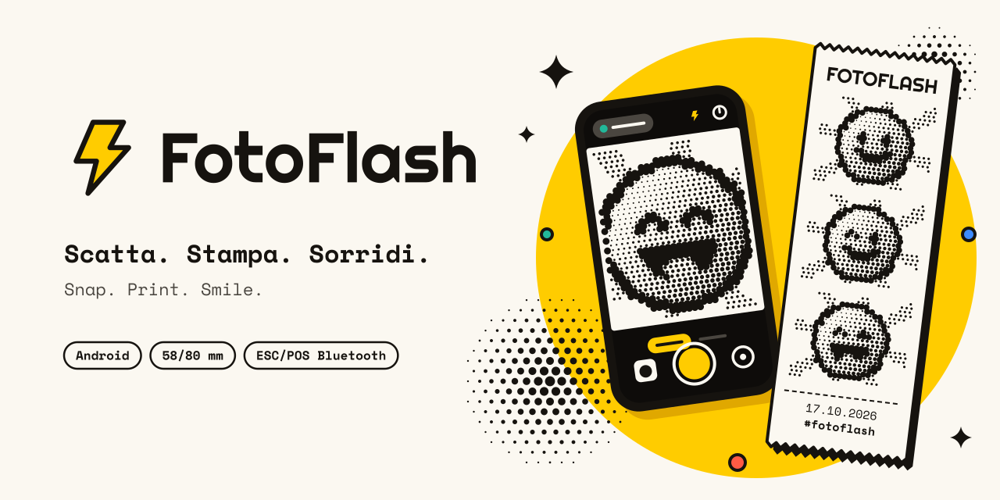

<p align="center">
  
</p>

<p align="center">
  <a href="https://github.com/nb-camelot/fotoflash/actions/workflows/ci.yml"></a>
  <a href="https://github.com/nb-camelot/fotoflash/releases/latest"></a>
  
  <a href="https://nb-camelot.github.io/fotoflash/"></a>
  <a href="LICENSE"></a>
</p>

# FotoFlash

**Scatta. Stampa. Sorridi.**

FotoFlash trasforma il telefono in una **fotocamera istantanea a carta termica**: come le fotocamere
per bambini che stampano lo scatto su uno scontrino, ma con il tuo telefono e una stampante termica
Bluetooth da 58 mm. Due tocchi, scatta e stampa: una foto ricordo in bianco e nero, retinata con
cura, pronta da strappare e regalare. Per feste, matrimoni, gite, giochi con i bambini, banchetti e
fotocabine fai da te.

- [Funzionalità](#funzionalità)
- [Stampanti compatibili](#stampanti-compatibili)
- [Installazione](#installazione)
- [Primo utilizzo](#primo-utilizzo)
- [Calibrazione](#calibrazione)
- [Versione web (PWA)](#versione-web-pwa)
- [Sviluppo](#sviluppo)
- [Rilasci e versioni](#rilasci-e-versioni)
- [Sviluppo agentico con /oc](#sviluppo-agentico-con-oc)
- [Configurazione del repository](#configurazione-del-repository)
- [Licenza e crediti](#licenza-e-crediti)

## Funzionalità

**Scatto**
- Mirino a tutto schermo con **anteprima termica dal vivo**: vedi già come verrà la foto retinata.
- Flash (auto/on/off), timer (0/3/10 s), fotocamera frontale o posteriore, import dalla galleria.
- **Tocca per esporre** sul soggetto e slider **±EV** per la compensazione dell'esposizione.
- **Salva gli scatti in galleria** (attivo di default): ogni foto finisce anche in Galleria › FotoFlash › Scatti.
- Modalità **Foto** e **Striscia** da fotocabina: 3 o 4 scatti con conto alla rovescia 3-2-1 e lampo
  bianco a ogni scatto.
- **Stampa istantanea**: scatta e stampa subito, senza passare dall'editor (modalità "fotocamera per bambini").
- Chip di stato della stampante sempre visibile: un tocco e sei alla schermata della stampante.

**Editor e stampa**
- Anteprima **WYSIWYG** su un foglio di carta con i bordi strappati: sono esattamente i punti che
  finiranno sulla carta.
- Quattro modelli: **Polaroid** · **Pieno** · **Striscia** · **Scontrino** (con intestazione,
  numero progressivo "RICORDO N. 0042" e "Grazie per il sorriso!").
- Didascalia, titolo dell'evento, hashtag, data e numerazione automatica.
- **Controluce**: contrasto locale adattivo (CLAHE), schiarisci ombre e controluce automatico, che
  riconosce il soggetto scuro su sfondo luminoso.
- Luminosità, contrasto, nitidezza, auto-livelli e quattro retini: **Atkinson**, Floyd-Steinberg,
  Bayer, Soglia. Testi sempre in nero pieno, mai retinati.
- Da 1 a 5 copie, avanzamento con stato reale della stampante e percentuale; se qualcosa va storto
  ti dice cosa e ti propone l'azione (Riprova · Scegli stampante · Apri Bluetooth).
- **Salva** in galleria (PNG della stampa) e **Condividi**.

**Storico e impostazioni**
- Ogni stampa entra nello storico: dettaglio, **ristampa**, condividi, salva la stampa, **salva le foto
  originali**, elimina; **Esporta tutte le foto** salva in galleria gli originali di tutto lo storico.
- Impostazioni per stampante, carta (58/80 mm), intensità, taglio, parametri avanzati di trasmissione,
  retino e regolazioni predefinite, evento, scatto.
- Inglese e italiano, tema chiaro e scuro (il mirino è sempre scuro).

## Stampanti compatibili

FotoFlash parla **ESC/POS** (immagini raster `GS v 0`) su **Bluetooth classico SPP**, con stampanti
già **accoppiate** nelle impostazioni di Android.

| Stampante | Supporto |
|---|---|
| Stampanti portatili ESC/POS da **58 mm** (384 punti) via Bluetooth classico — le classiche "mini stampanti per scontrini" che si accoppiano con PIN `0000` o `1234` | Sì: è il caso principale |
| Stampanti ESC/POS da **80 mm** (576 punti) via Bluetooth classico | Sì, scegliendo 80 mm in Impostazioni → Stampante e carta → Carta |
| "**Cat printer**" e mini stampanti **BLE** a protocollo proprietario (GB01, GB02, GB03, MX05, MX06, MX10 e simili, quelle che si usano solo dalla loro app) | Non ancora: in [roadmap](docs/ROADMAP.md), piano pronto in [`issue_plans/ble-cat-printer.md`](issue_plans/ble-cat-printer.md) |
| Stampanti di etichette a protocollo proprietario, stampanti USB o Wi-Fi | No |

Come capire se la tua va bene: se compare tra i **dispositivi accoppiati** di Android e il produttore
dichiara ESC/POS, quasi certamente sì. Se invece non si accoppia dalle impostazioni e funziona solo
dalla sua app, è una stampante BLE proprietaria.

## Installazione

- **Versione stabile**: scarica `fotoflash-X.Y.Z.apk` dall'ultima
  [Release](https://github.com/nb-camelot/fotoflash/releases/latest), aprilo sul telefono e consenti
  l'installazione da quella app (browser o file manager). Serve Android 8.0 o successivo. Gli
  aggiornamenti si installano sopra la versione precedente: sono tutti firmati con la stessa chiave
  (l'impronta del certificato è scritta nelle note di ogni release).
- **Versione di sviluppo**: ogni build verde della CI pubblica l'APK di debug come artifact
  `fotoflash-debug-<n>` (Actions → run → Artifacts; serve essere loggati su GitHub). Ha
  `applicationId` `io.github.nik2208.fotoflash.debug`, quindi **convive** con la versione stabile, e
  tutte le build di debug hanno la stessa firma: si aggiornano senza disinstallare.
- **Senza installare l'APK**: apri [nb-camelot.github.io/fotoflash](https://nb-camelot.github.io/fotoflash/)
  con Chrome (Android o computer) o Edge e stampa direttamente dal browser via Bluetooth LE. Vedi
  [Versione web (PWA)](#versione-web-pwa).

## Primo utilizzo

1. Accendi la stampante e **accoppiala** dalle impostazioni Bluetooth di Android (PIN tipico `0000` o `1234`).
2. Apri FotoFlash: tre schede di benvenuto, poi i permessi (fotocamera; su Android 12+ «Dispositivi
   nelle vicinanze» per il Bluetooth).
3. Scegli la stampante tra quelle accoppiate e stampa la **pagina di prova**. Puoi anche saltare e
   sceglierla dopo.
4. Scatta, guarda l'anteprima, premi **Stampa**. Fatto.

Consiglio per le feste: attiva **Stampa istantanea** e imposta titolo e hashtag dell'evento in
Impostazioni → Evento; ogni scatto esce già impaginato e numerato.

## Calibrazione

Le stampanti economiche non hanno controllo di flusso e hanno buffer piccoli: una foto pesa circa
dieci volte uno scontrino. FotoFlash invia l'immagine **a bande** e **a blocchi** con una **pausa**
tra un blocco e l'altro. I valori predefiniti vanno bene per la maggior parte delle stampanti; se la
tua fa i capricci, stampa la pagina di prova e regola qui (Impostazioni → Stampante e carta: sezioni
Carta, Intensità di stampa e Calibrazione avanzata, quest'ultima da aprire con un tocco).

| Parametro | Predefinito | Intervallo | A cosa serve |
|---|---|---|---|
| Intensità | 0 (default della stampante) | 0-4 | Tempo di riscaldamento della testina: più alto = più scuro, più lento |
| Avanzamento dopo la stampa | 4 righe | 0-10 | Carta in più per strappare sotto la foto |
| Taglio carta | no | sì/no | Solo per stampanti con taglierina |
| Dimensione blocco | 256 byte | 64-1024 | Byte per scrittura sul Bluetooth |
| Pausa tra blocchi | 15 ms | 0-60 ms | Tempo lasciato alla stampante per svuotare il buffer |
| Altezza banda | 24 righe | 8-255 | Righe per comando raster `GS v 0` |

| Sintomo | Rimedio |
|---|---|
| La stampa si interrompe a metà, esce "spazzatura" o righe sfasate | Buffer saturo: blocco 128, pausa 25-40 ms, banda 16 |
| Strisce bianche orizzontali regolari | La stampante si ferma tra le bande: aumenta l'altezza banda (48-96) |
| Foto chiare e slavate | Intensità 2-3; nell'editor più contrasto o meno luminosità |
| Foto scure e impastate | Intensità più bassa, più luminosità, retino Atkinson |
| Stampa lenta ma pulita | Prova blocco più grande o pausa più corta, un passo alla volta |
| Margine destro tagliato | Controlla la larghezza della carta (58 o 80 mm) |
| «Stampante occupata» | Il Bluetooth classico accetta una connessione sola: chiudi le altre app che la usano |

## Versione web (PWA)

**[nb-camelot.github.io/fotoflash](https://nb-camelot.github.io/fotoflash/)** è FotoFlash nel browser,
senza installare l'APK. Scatta, compone le stampe con gli stessi modelli, regolazioni e retini
dell'app (il motore è il porting di `core-thermal`, verificato con gli stessi valori dei test
Kotlin: stesse impostazioni, stessa carta), tiene lo storico e **stampa direttamente dal browser via
Web Bluetooth (BLE)**. Si installa come un'app e, dopo il primo avvio, si apre anche offline.

**Browser supportati**

| Browser | Scatto, modelli, storico, salvataggio | Stampa Bluetooth |
|---|---|---|
| Chrome su Android | Sì | Sì |
| Chrome ed Edge su Windows 10+, macOS, ChromeOS | Sì | Sì |
| Samsung Internet, Opera su Android | Sì | Di solito sì, non verificato |
| Chrome su Linux | Sì | Solo con `chrome://flags/#enable-experimental-web-platform-features` (BlueZ 5.41+) |
| Firefox (ogni piattaforma), Safari su macOS | Sì | No: manca Web Bluetooth |
| iPhone e iPad (ogni browser) | Sì | No: vedi *Limiti su iOS* |

**Stampanti.** Il browser parla con la stampante via **Bluetooth LE**, non con il Bluetooth classico
(SPP) dell'app Android. Vanno le stampanti termiche ESC/POS da 58 e 80 mm che espongono un canale
seriale BLE: il profilo `18F0/2AF1` delle comuni "BlueTooth Printer" e Netum (quello verificato), e i
canali `FF00`, `FFE0`, ISSC, `E7810A71` e Nordic UART. Molte mini stampanti hanno sia il classico sia
il BLE: col browser non serve accoppiarle nelle impostazioni del telefono, si sceglie la stampante dal
selettore che apre Chrome. Le "cat printer" (servizio `AE30`) vengono riconosciute e rifiutate con un
messaggio chiaro: hanno un protocollo proprio. Se la tua stampante funziona solo in Bluetooth classico,
usa l'app Android.

**Installarla**
- **Android, Chrome**: FotoFlash propone *Installa* da sola; altrimenti menu ⋮ → *Installa app* (o
  *Aggiungi a schermata Home*). Si apre a tutto schermo, come un'app.
- **Computer, Chrome o Edge**: icona di installazione nella barra degli indirizzi, oppure menu →
  *Installa FotoFlash*.
- **iPhone e iPad**: in Safari, *Condividi* → *Aggiungi alla schermata Home*.

Quando esce una versione nuova, l'app lo dice e si aggiorna con un tocco su *Aggiorna* (mai durante
una stampa). Chrome può ricordare la stampante tra una visita e l'altra solo se il browser lo consente;
altrimenti, dopo una ricarica, basta un tocco per ricollegarla: Web Bluetooth chiede sempre un gesto
dell'utente per scegliere un dispositivo.

**Limiti su iOS.** Su iPhone e iPad tutti i browser usano WebKit, che non ha Web Bluetooth: la PWA
scatta, compone, salva e condivide, ma **non stampa**, e lo dice. Per stampare usa l'app Android,
oppure Chrome su Android o su un computer. Conviene aggiungerla alla schermata Home: Safari può
cancellare i dati dei siti che non apri da qualche giorno, storico compreso.

**Sviluppo locale.** Serve solo Node 20 o successivo: niente `npm install`, niente bundler,
nessuna dipendenza. Le regole e i contratti dei moduli sono in [`docs/WEB.md`](docs/WEB.md).

```bash
node web/dev-server.mjs              # http://127.0.0.1:5173/ (PORT=8080 per un'altra porta)
node --test web/tests/*.test.mjs     # test: motore (parità con Kotlin), store, stampante, import e testi
node scripts/build-web.mjs dist      # il sito come su Pages; le icone PNG solo se c'è rsvg-convert
```

Il server locale serve `web/` e prende font, brand sheet e licenze direttamente dal repository; in
locale il service worker va sempre in rete, così ogni modifica si vede ricaricando. `127.0.0.1` è un
contesto sicuro, quindi fotocamera e Web Bluetooth funzionano senza HTTPS. Per provare sul telefono
collegalo via USB con il debug attivo, apri `chrome://inspect` → *Port forwarding* `5173` →
`127.0.0.1:5173` (il server ascolta solo lì) e sul telefono apri `http://localhost:5173/`: anche
`localhost` è un contesto sicuro. Da Node 21 `node --test` non esplora
più una cartella: passa i file (`web/tests/*.test.mjs`), come fanno i workflow.

**Pubblicazione.** [`.github/workflows/pages.yml`](.github/workflows/pages.yml) gira a ogni push su
`main`, cioè a ogni rilascio, e a mano (*Run workflow* scegliendo `main`; lanciato su un altro branch
non pubblica nulla): test, icone PNG da
`docs/brand/icon.svg` con `rsvg-convert`, `scripts/build-web.mjs` (versione di `gradle.properties` più
lo sha corto del commit, nome della cache del service worker, verifica che manifest, precache,
`index.html` e CSS puntino a file veri) e deploy su GitHub Pages. La CI di ogni push (`ci.yml`, job *Web
(PWA)*) esegue gli stessi test e una build di controllo. Il commit di versione di `bump-version`
contiene `[skip ci]`, quindi il sito pubblicato al merge mostra ancora il numero precedente (con lo sha
giusto): per allinearlo, *Run workflow* di `pages.yml` su `main` dopo la release.

## Sviluppo

| Modulo | Contenuto |
|---|---|
| `:core-thermal` | Kotlin/JVM puro, senza Android: immagini in grigio e a 1 bit, regolazioni tonali, retinatura, impaginazione dei modelli, comandi ESC/POS. Tutto testato con JUnit. |
| `:app` | Android con Jetpack Compose: fotocamera (CameraX), rendering dei modelli (Canvas e font), Bluetooth SPP, storico, impostazioni, UI. |

Documenti da leggere prima di scrivere codice:
[`docs/SPEC.md`](docs/SPEC.md) (prodotto), [`docs/ARCHITECTURE.md`](docs/ARCHITECTURE.md)
(architettura e **contratti vincolanti**), [`docs/brand/BRAND.md`](docs/brand/BRAND.md) (brand),
[`AGENTS.md`](AGENTS.md) (regole operative), [`CONTRIBUTING.md`](CONTRIBUTING.md).

**La build si fa in CI.** Versioni bloccate e verificate dalla CI: Gradle 8.10.2, AGP 8.7.2,
Kotlin 2.0.21, JDK 17, compileSdk/targetSdk 35, minSdk 26, Compose BOM 2024.12.01. Il repository non
ha il wrapper Gradle: CI, bump di versione e agente installano Gradle 8.10.2 e lanciano

```bash
gradle --no-daemon :core-thermal:test :app:testDebugUnitTest :app:assembleDebug
```

In locale serve lo stesso Gradle (o Android Studio Ladybug o successivo), JDK 17 e l'SDK 35.
La versione web invece si sviluppa e si testa con il solo Node: vedi
[Versione web (PWA)](#versione-web-pwa) e [`docs/WEB.md`](docs/WEB.md).

**Leggere il «FotoFlash build report».** Quando la CI fallisce, il workflow `ci.yml` pubblica sul
commit un check run chiamato *FotoFlash build report* con: errori Kotlin con file e riga (anche come
annotazioni sul codice), errori di risorse/AAPT/manifest, test falliti e il blocco *What went wrong*
di Gradle. Lo trovi nella scheda Checks della PR, nel riepilogo della run, oppure via API (utile agli
agenti):

```bash
gh api repos/nb-camelot/fotoflash/commits/<sha>/check-runs \
  --jq '.check_runs[] | select(.name=="FotoFlash build report") | .output.text'
```

I report HTML completi dei test sono nell'artifact `test-reports-<n>`.

```
fotoflash/
├── app/                    app Android (Compose)
├── core-thermal/           motore di stampa termica, JVM puro
├── web/                    versione web (PWA): moduli ES senza dipendenze, test node --test
├── scripts/                build-web.mjs, la build del sito di GitHub Pages
├── docs/                   SPEC, ARCHITECTURE, WEB, brand, licenze, ROADMAP
├── issue_plans/            piani pronti per l'agente
├── signing/                keystore di debug condiviso (la chiave di release non sta mai qui)
├── .github/workflows/      ci, bump-version, release, pages, opencode
├── AGENTS.md               regole per agenti e persone
└── CHANGELOG.md
```

## Rilasci e versioni

```
 feature/fix ──PR──► dev ──PR (persona)──► main ──► bump-version ──► release
                      ▲                              build + test     APK firmato
           /oc ──► opencode/issue-N                  commit + tag     Release GitHub
```

- **`dev`** riceve tutte le PR (anche quelle dell'agente). **`main`** è il rilascio: ogni push su
  `main`, cioè ogni merge di `dev`, produce una versione.
- `bump-version.yml` valuta **tutti i commit arrivati su `main` dall'ultimo tag**, compila e testa
  (stessi step della CI, più la build di release non firmata: R8, riduzione delle risorse e
  `lintVitalRelease` girano prima del tag) e **solo se è tutto verde** aggiorna `VERSION_NAME`/`VERSION_CODE` in
  `gradle.properties`, crea il commit `chore(release): vX.Y.Z [skip ci]` e il tag `vX.Y.Z`. Poi chiama
  `release.yml` come job dello stesso workflow (un push fatto con `GITHUB_TOKEN` non avvierebbe altri
  workflow).
- `release.yml` compila dal tag l'APK di release **firmato**, verifica firma, certificato,
  `applicationId` e versione, e pubblica la Release con `fotoflash-X.Y.Z.apk`, il suo SHA-256, le note
  generate da GitHub e la sezione del `CHANGELOG.md`. Se mancano i secret di firma si ferma con un
  errore: non ripiega mai sulla chiave di debug. Se la release esiste già, si ferma.
- `pages.yml` pubblica la versione web a ogni push su `main`, in parallelo a `bump-version`: vedi
  [Versione web (PWA)](#versione-web-pwa), *Pubblicazione*.

| Commit (titolo della PR) | Bump |
|---|---|
| `[semver:major]` / `[semver:minor]` / `[semver:patch]` nel messaggio | quello indicato, prima di tutto il resto |
| `tipo!: …` oppure footer `BREAKING CHANGE: …` | major |
| `feat: …` | minor |
| `fix: …`, `perf: …` | patch |
| tutto il resto | patch |

Vince il bump più alto tra i commit del rilascio. Il **primo rilascio** (nessun tag) pubblica la
versione già scritta in `gradle.properties` (0.1.0). `[skip release]` nell'ultimo commit salta il
rilascio; *Run workflow* su `bump-version.yml` permette di forzare `patch`/`minor`/`major` (va
lanciato scegliendo il branch **`main`**: con `dev`, che è il branch di default, il job viene saltato
senza messaggi); *Run workflow* su `release.yml` rifà la release di un tag esistente (per esempio dopo aver configurato i
secret). Per avere note di rilascio precise, prima della PR `dev → main` rinomina in `CHANGELOG.md`
la sezione `## [Unreleased]` in `## [X.Y.Z] - AAAA-MM-GG`; se non lo fai, la release usa la sezione
`Unreleased`. Il bump di versione resta su `main`: `dev` mantiene il numero precedente finché non
riporti `main` in `dev`, e va bene così (nessun conflitto, nessuno tocca a mano `VERSION_*`).

## Sviluppo agentico con /oc

FotoFlash può crescere da solo: si apre un'issue ben scritta, si scrive `/oc`, e l'agente
[OpenCode](https://github.com/anomalyco/opencode) pianifica, implementa, compila, si fa revisionare e
apre la PR. Il flusso è in [`.github/workflows/opencode.yml`](.github/workflows/opencode.yml):

1. **Comando** — un commento che **comincia** con `/oc` (o `/opencode`) su un'issue o una PR, oppure
   una riga `/oc` nel corpo di un'issue nuova (i modelli di issue hanno il campo apposta), oppure
   *Run workflow* con una richiesta. Facoltativo: `--model provider/modello`.
2. **Autorizzazione** — conta il ruolo di **chi scrive il comando**: OWNER, COLLABORATOR o un utente
   in `OPENCODE_ALLOWED_USERS`. Le PR da fork e i branch `main`/`master`/`dev` sono rifiutati.
3. **Piano** — un agente in sola lettura scrive `issue_plans/opencode-issue-<n>.md` (o usa il piano
   pronto citato nel comando, nell'issue o nella PR, per esempio `issue_plans/collage-2x2.md`).
4. **Build** — l'agente implementa, partendo da `AGENTS.md` e dai contratti di `docs/ARCHITECTURE.md`;
   poi il workflow esegue la build Gradle e, se fallisce, rimanda gli errori all'agente.
5. **Review** — un agente in sola lettura verifica i criteri del piano e la richiesta corrente; conta
   solo l'ultima riga, `VERDICT: PASS` o `VERDICT: FAIL`. Fino a 4 giri build/review (di solito 1-2,
   entro un budget di 45 minuti: i timeout di OpenCode si accorciano al tempo che resta al job).
6. **PR verso `dev`** — su un runner pulito il workflow controlla il lavoro (niente modifiche a
   `.github/`, `signing/`, `VERSION_*`), pusha `opencode/issue-<n>`, apre la PR e avvia la CI.
7. **Merge** — squash-merge **della sola PR dell'agente**, solo con review PASS, check «Build e test»
   verde sul commit revisionato e issue aperta da un owner, un collaboratore o un utente di
   `OPENCODE_ALLOWED_USERS` (una PR nata da *Run workflow* non ha un'issue collegata: dopo un `/oc`
   sulla PR il merge lo decide una persona). Altrimenti la PR resta aperta (in bozza se la review non è passata):
   commenta `/oc <cosa correggere>` sulla PR per un altro giro. Se due run lavorano sullo stesso
   branch, la seconda salva il suo lavoro su `opencode/issue-<n>-r<run>` senza PR né merge.
8. **Rilascio** — resta una decisione umana: PR `dev → main`.

Il `GITHUB_TOKEN` non può pushare commit che cambiano `.github/workflows/`: se nel frattempo `dev` ha
workflow nuovi, il workflow non riallinea un branch `opencode/…` già esistente (lo avvisa nel log) e
la PR resta indietro rispetto a `dev`. Si mergia lo stesso; se ci sono conflitti, aggiorna il branch a
mano.

Esempi:

```
/oc
/oc segui issue_plans/collage-2x2.md
/oc --model anthropic/claude-sonnet-4-5 il modello Striscia deve supportare 4 foto anche su 80 mm
```

Sicurezza in breve: l'agente gira con un token in **sola lettura** e senza credenziali git; le chiavi
dei modelli sono solo negli step che le usano; OpenCode è bloccato a una versione con SHA-256
verificato; push, PR e merge avvengono in un job separato che non esegue il codice dell'agente; il
merge automatico tocca solo `dev`. Il testo di un'issue entra nel prompt: affida all'agente solo
issue di cui ti fidi. I commenti HTML (`<!-- … -->`), invisibili nella pagina dell'issue, vengono
tolti dal contesto. Il verdetto della review e l'esito della build nel runner dell'agente sono
prodotti in un ambiente **non fidato** (l'agente esegue comandi liberamente) e **non sono una
barriera di sicurezza**: per questo le issue aperte da utenti esterni non vengono mai mergiate in
automatico, anche se un owner scrive `/oc`. L'unico controllo indipendente resta la CI, e una PR
`dev → main` la decide sempre una persona.

## Configurazione del repository

### Impostazioni (una volta sola)

1. **Branch**: imposta `dev` come **branch di default** (Settings → General → Default branch).
   **Obbligatorio**: GitHub esegue i comandi `/oc` (eventi su issue e commenti) con il workflow **del
   branch di default** e da lì legge anche i modelli di issue. Finché il default è `main`, che contiene
   solo `ci.yml`, `/oc` non avvia niente (nessuna run, nessun errore) e i moduli Bug e Funzionalità con
   il campo *Affida all'agente* non compaiono. Con `dev` di default le PR puntano lì e "Closes #n"
   chiude le issue al merge (il workflow comunque chiude da solo quelle risolte dall'agente).
   Alternativa: portare su `main` i soli file di `.github/` (più `README.md`) con un commit che
   contiene `[skip release]`. Con `dev` di default, *Run workflow* di `bump-version.yml` va lanciato
   scegliendo `main`.
2. **Settings → Actions → General**: abilita *Allow GitHub Actions to create and approve pull
   requests* (senza, l'agente non può aprire la PR). I permessi dei token sono dichiarati job per job
   nei workflow, quindi *Workflow permissions* può restare in sola lettura.
3. **Regole dei branch** (Settings → Rules → Rulesets). Il check «Build e test» diventa selezionabile
   dopo la prima run della CI.
   - **`dev`**: *Require status checks to pass* con **Build e test**; *Block force pushes*;
     *Restrict deletions*. Niente review obbligatorie e niente "branch aggiornato rispetto a dev",
     altrimenti l'agente non può mergiare da solo.
   - **`main`**: *Require a pull request before merging* (con o senza review), *Require status checks*
     con **Build e test**, *Block force pushes*, *Restrict deletions*. Nella **Bypass list** aggiungi
     **Deploy keys**: `bump-version` pusha il commit di versione con la deploy key del secret
     `RELEASE_DEPLOY_KEY` (il `GITHUB_TOKEN` non può aggirare le regole). Senza deploy key, `main` non
     deve avere regole che blocchino quel push.
   - Facoltativo: aggiungi a entrambe anche il check **Web (PWA)**, il job della versione web in
     `ci.yml` (test di `web/` e build di controllo del sito).
4. **GitHub Pages** (per la versione web): Settings → Pages → *Build and deployment* → Source
   **GitHub Actions**. Poi Settings → Environments → **github-pages** → *Deployment branches and
   tags*: aggiungi **`main`**. GitHub crea l'ambiente con una regola che di solito ammette solo il
   branch di default (qui `dev`), e senza `main` il deploy fallisce con *Branch "main" is not allowed
   to deploy to github-pages due to environment protection rules*.

### Secret (Settings → Secrets and variables → Actions → Secrets)

| Secret | Obbligatorio | A cosa serve |
|---|---|---|
| `SIGNING_KEYSTORE_BASE64` | per le release | Keystore **PKCS12** di release, in base64 |
| `SIGNING_STORE_PASSWORD` | per le release | Password del keystore |
| `SIGNING_KEY_ALIAS` | per le release | Alias della chiave |
| `SIGNING_KEY_PASSWORD` | per le release | Password della chiave (in PKCS12 di solito uguale a quella del keystore) |
| `RELEASE_DEPLOY_KEY` | se `main` è protetto | Chiave privata di una deploy key **con scrittura**, nella bypass list di `main` |
| `OPENCODE_API_KEY`, `ANTHROPIC_API_KEY`, `OPENAI_API_KEY`, `GEMINI_API_KEY` | no | Solo per usare modelli a pagamento con `--model` |

### Variabili (stessa pagina, scheda Variables)

| Variabile | Default | A cosa serve |
|---|---|---|
| `OPENCODE_ALLOWED_USERS` | vuota | Utenti extra che possono usare `/oc`, separati da spazi |
| `OPENCODE_DEFAULT_MODEL` | `opencode/big-pickle` | Modello di default dell'agente (gratuito) |
| `OPENCODE_VISUAL_MODEL` | `opencode/space-bunny-free` | Modello per richieste con immagini |
| `OPENCODE_MAX_ITERATIONS` | `4` | Giri build/review per run |
| `OPENCODE_AUTO_MERGE` | `true` | `false` lascia sempre la PR aperta per una persona |
| `RELEASE_CERT_SHA256` | vuota | Impronta SHA-256 attesa del certificato di release: se cambia, la release si ferma |

### Firma di release

```bash
# 1. Keystore PKCS12 (conservalo fuori dal repo: perderlo vuol dire non poter più aggiornare l'app)
keytool -genkeypair -v -storetype PKCS12 -keystore fotoflash-release.p12 \
  -alias fotoflash -keyalg RSA -keysize 4096 -validity 10000 \
  -dname "CN=FotoFlash, O=Nicola Brecciaroli"

# 2. Secret (con la GitHub CLI)
base64 -w0 fotoflash-release.p12 | gh secret set SIGNING_KEYSTORE_BASE64
gh secret set SIGNING_STORE_PASSWORD
gh secret set SIGNING_KEY_ALIAS --body fotoflash
gh secret set SIGNING_KEY_PASSWORD

# 3. Impronta del certificato da bloccare (oppure copiala dall'avviso della prima release)
keytool -list -v -keystore fotoflash-release.p12 -storetype PKCS12 | grep SHA256
gh variable set RELEASE_CERT_SHA256 --body "<impronta>"
```

Su Windows (PowerShell) il base64 si ottiene con
`[Convert]::ToBase64String([IO.File]::ReadAllBytes("fotoflash-release.p12"))`.

### Deploy key per i rilasci

```bash
ssh-keygen -t ed25519 -N "" -C "fotoflash release" -f fotoflash-release-key
gh repo deploy-key add fotoflash-release-key.pub --allow-write --title "bump-version"
gh secret set RELEASE_DEPLOY_KEY < fotoflash-release-key
```

Poi aggiungi *Deploy keys* alla bypass list della regola di `main`.

## Licenza e crediti

Codice sotto licenza **MIT** — vedi [`LICENSE`](LICENSE). © 2026 Nicola Brecciaroli.

Caratteri inclusi nell'app, non modificati, sotto **SIL Open Font License 1.1**:
- **Righteous** — © 2011 Brian J. Bonislawsky DBA Astigmatic (AOETI), [`docs/licenses/OFL-Righteous.txt`](docs/licenses/OFL-Righteous.txt)
- **Space Mono** — © 2016 The Space Mono Project Authors, [`docs/licenses/OFL-SpaceMono.txt`](docs/licenses/OFL-SpaceMono.txt)

Il flusso agentico deriva da quello di
[Raw BT Print Bridge](https://github.com/nb-camelot/raw-bt-print-bridge), con le correzioni di
sicurezza e di rilascio emerse dalla sua analisi.
